# Práctica Apache en Ubuntu 24.04

**Alumno:** Daviti Gvaramia
**Curso:** 2º SMR (Sistemas Microinformáticos y Redes)
**Módulo:** Aplicaciones Web
**Fecha:** 16/10/2026

---

## Índice

1. [Preparación del sistema](#apartado-1-preparación-del-sistema)
2. [Instalación de Apache](#apartado-2-instalación-de-apache)
3. [Comprobación del funcionamiento](#apartado-3-comprobación-del-funcionamiento)
4. [Comandos principales](#apartado-4-comandos-principales)
5. [Ficheros y directorios importantes](#apartado-5-ficheros-y-directorios-importantes)
6. [Modificaciones del servicio](#apartado-6-modificaciones-del-servicio)
7. [Módulos de Apache](#apartado-7-módulos-de-apache)
8. [Virtual Hosts](#apartado-8-virtual-hosts)
9. [Permisos y propietarios](#apartado-9-permisos-y-propietarios)
10. [Conclusiones y problemas](#conclusiones-y-problemas)

He hecho la práctica en una máquina virtual con Ubuntu 24.04.5 LTS. Mi usuario es `daviti_` y el equipo se llama `daviti`.

---

## Apartado 1. Preparación del sistema

Lo primero es actualizar el sistema antes de instalar nada, para tener los paquetes al día.

### 1.1. Actualizar la lista de paquetes

```bash
sudo apt update
```

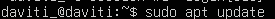

Este comando no instala nada, solo descarga la lista nueva de paquetes que hay en los repositorios. Hay que hacerlo antes que el upgrade, si no apt no sabe que hay versiones nuevas.

### 1.2. Actualizar los paquetes

```bash
sudo apt upgrade -y
```


Aquí ya sí se actualizan todos los paquetes que tienen versión nueva. El `-y` es para que no pregunte si quiero continuar y diga que sí directamente.

### 1.3. Ver la versión de Ubuntu

```bash
lsb_release -a
```

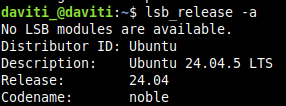

Con esto compruebo que tengo Ubuntu 24.04.5 LTS (se llama noble), que es la que pide la práctica. LTS quiere decir que tiene soporte durante muchos años, por eso se usa en servidores. Lo de "No LSB modules are available" no es un error, sale siempre.

---

## Apartado 2. Instalación de Apache

### 2.1. Instalar Apache

```bash
sudo apt install apache2 -y
```


Instala el servidor web Apache. Cuando termina, Ubuntu ya lo arranca solo y lo deja puesto para que se inicie cada vez que enciendo la máquina.

### 2.2. Ver la versión

```bash
apache2 -v
```

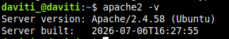

Tengo la versión 2.4.58 de Apache.

### Pregunta: ¿Qué paquetes adicionales se han instalado como dependencias?

Al instalar apache2 también se instalan otros paquetes que necesita para funcionar:

- **apache2-bin**: el programa de Apache en sí.
- **apache2-data**: archivos como la página de bienvenida y los iconos.
- **apache2-utils**: herramientas extra, como `htpasswd` (para crear usuarios con contraseña) o `ab` (para hacer pruebas de carga).
- **libapr1t64 y libaprutil1t64**: librerías que usa Apache por debajo.
- **libaprutil1-dbd-sqlite3 y libaprutil1-ldap**: más librerías, para bases de datos y LDAP.
- **liblua5.4-0**: librería de Lua.
- **ssl-cert**: sirve para crear un certificado de prueba para HTTPS.

Esto sale en la salida de apt donde pone "Se instalarán los siguientes paquetes adicionales". También se puede mirar después en el historial de apt:

```bash
grep -A3 "install apache2" /var/log/apt/history.log
```

---

## Apartado 3. Comprobación del funcionamiento

### 3.1. Estado del servicio

```bash
sudo systemctl status apache2
```

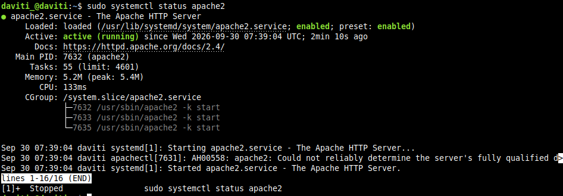

Lo importante de aquí:

- Pone **active (running)**, o sea que Apache está funcionando.
- Pone **enabled**, que significa que arranca solo al encender el equipo.
- El **Main PID 7632** es el proceso principal, y debajo salen otros procesos que son los que atienden las visitas.
- Abajo sale un aviso (AH00558) que dice que no puede saber el nombre del servidor. No es grave, Apache funciona igual. Lo arreglo en el apartado 6.3.

### 3.2. Puertos en escucha

```bash
sudo ss -tulpn | grep apache2
```

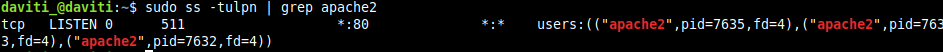

`ss` enseña los puertos que están abiertos y con `grep` me quedo solo con los de Apache. Se ve que Apache está escuchando en el **puerto 80**, que es el de HTTP. El asterisco quiere decir que escucha en todas las IPs, así que se puede entrar también desde otro ordenador.

### 3.3. Prueba con curl y navegador

```bash
curl -I http://localhost
```

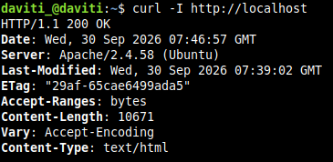

`curl -I` hace una petición a la web y enseña solo las cabeceras. Sale **200 OK**, que quiere decir que la página carga bien. Los 10671 bytes son lo que ocupa la página por defecto de Apache.

Si en el navegador pongo la IP del servidor (la saco con `ip a`) sale la página "Apache2 Ubuntu Default Page".

### 3.4. Firewall

```bash
sudo ufw status
```

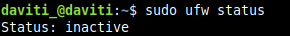

En mi máquina el firewall está desactivado, por eso Apache ya funcionaba sin tocar nada. Aun así añado la regla por si lo activo más adelante:

```bash
sudo ufw allow 'Apache'
```

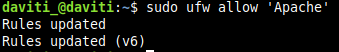

La regla se pone dos veces, una para IPv4 y otra para IPv6.

### Pregunta: ¿Qué diferencia hay entre los perfiles Apache, Apache Full y Apache Secure?

| Perfil | Puertos | Para qué |
|---|---|---|
| Apache | 80 | Solo HTTP (sin cifrar). Es el que he usado yo |
| Apache Secure | 443 | Solo HTTPS (cifrado) |
| Apache Full | 80 y 443 | Los dos a la vez |

Se pueden ver todos con `sudo ufw app list`.

---

## Apartado 4. Comandos principales

| Comando | Qué hace |
|---|---|
| `sudo systemctl start apache2` | Arranca Apache |
| `sudo systemctl stop apache2` | Para Apache y la web deja de funcionar |
| `sudo systemctl restart apache2` | Lo para y lo vuelve a arrancar. Corta a la gente que esté conectada |
| `sudo systemctl reload apache2` | Vuelve a leer la configuración pero sin cortar a nadie |
| `sudo systemctl enable apache2` | Hace que arranque solo al encender el equipo |
| `sudo systemctl disable apache2` | Quita que arranque solo |
| `apache2ctl configtest` | Mira si la configuración tiene errores. Si está bien dice `Syntax OK` |
| `apache2ctl -S` | Enseña los sitios web (virtual hosts) que hay cargados |
| `apache2ctl -M` | Enseña los módulos que están cargados |
| `a2enmod` / `a2dismod` | Activar / desactivar un módulo |
| `a2ensite` / `a2dissite` | Activar / desactivar un sitio |
| `a2enconf` / `a2disconf` | Activar / desactivar un archivo de configuración |

Casi todos estos comandos los he ido usando durante la práctica, sobre todo `configtest` y `reload` cada vez que cambiaba algo.

Un truco que he aprendido: hacer siempre `configtest` antes de reiniciar. Si hay un fallo en la configuración y reinicias, Apache no arranca y te quedas sin web.

### Pregunta: ¿Cuándo conviene usar reload en lugar de restart?

**reload** se usa cuando solo he cambiado la configuración, por ejemplo un sitio o una página de error. Apache coge los cambios sin pararse, así que la gente que está en la web no nota nada.

**restart** hace falta cuando activo o desactivo módulos, porque los módulos solo se cargan al arrancar. De hecho, cuando haces `a2enmod` te lo dice: "you need to run systemctl restart apache2". El problema es que corta todas las conexiones.

---

## Apartado 5. Ficheros y directorios importantes

### 5.1. Contenido de /etc/apache2

```bash
ls -l /etc/apache2/
```

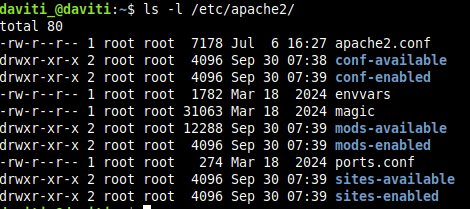

Aquí está toda la configuración de Apache. Todo es de root, por eso para editar cualquier cosa hay que poner `sudo`. Se ve que hay carpetas por parejas: available y enabled.

### 5.2. Tabla de ficheros

| Ruta | Para qué sirve |
|---|---|
| `/etc/apache2/apache2.conf` | Es el archivo de configuración principal, desde aquí se cargan todos los demás |
| `/etc/apache2/ports.conf` | Aquí se pone en qué puerto escucha Apache (el 80 por defecto) |
| `/etc/apache2/sites-available/` | Están todos los sitios web que he creado, aunque no estén activados |
| `/etc/apache2/sites-enabled/` | Solo los sitios que están activados. Son enlaces a los de sites-available |
| `/etc/apache2/mods-available/` y `mods-enabled/` | Lo mismo pero con los módulos: todos los que hay y los que están activos |
| `/etc/apache2/conf-available/` y `conf-enabled/` | Lo mismo pero con trozos de configuración extra |
| `/etc/apache2/envvars` | Variables que usa Apache, por ejemplo el usuario con el que funciona (www-data) |
| `/var/www/html/` | La carpeta de la web. Lo que meto aquí es lo que se ve en el navegador |
| `/var/log/apache2/access.log` | Guarda todas las visitas que recibe la web |
| `/var/log/apache2/error.log` | Guarda los errores. Es lo primero que hay que mirar si algo falla |

### 5.3. Enlaces simbólicos

```bash
ls -l /etc/apache2/sites-enabled/
```

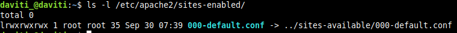

La `l` del principio y la flecha `->` significan que es un enlace simbólico, como un acceso directo de Windows. El archivo de verdad está en sites-available.

### Pregunta: ¿Por qué Apache usa enlaces simbólicos entre *-available y *-enabled?

Porque así puedo activar y desactivar cosas sin borrar nada. Cuando activo un sitio con `a2ensite` solo se crea el enlace, y cuando lo desactivo con `a2dissite` solo se borra el enlace. El archivo original sigue en available, así que si lo quiero volver a activar no tengo que escribirlo otra vez.

Además el archivo solo existe una vez, así que si lo edito el cambio vale directamente, no hay copias distintas por ahí.

---

## Apartado 6. Modificaciones del servicio

### 6.0. Copia de seguridad

```bash
sudo cp /etc/apache2/apache2.conf /etc/apache2/apache2.conf.bak
```

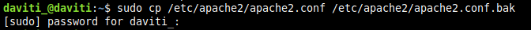

Antes de cambiar nada hago una copia del archivo. Si la lío, solo tengo que volver a copiar el .bak encima y queda como estaba.

### 6.1. Cambiar la página de inicio

```bash
echo "<h1>Servidor de DAVITI</h1>" | sudo tee /var/www/html/index.html
```

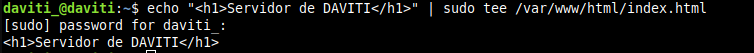

Con esto cambio la página principal por una mía. Uso `sudo tee` y no `sudo echo >` porque con `>` el que escribe el archivo es mi usuario normal, y no tiene permiso en esa carpeta.

Que el cambio ha funcionado se ve en la captura del siguiente punto: la página ahora ocupa 28 bytes y no 10671 como la de antes.

### 6.2. Cambiar el puerto al 8080

Hay que cambiar dos archivos:

```bash
sudo nano /etc/apache2/ports.conf
```

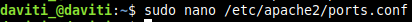

En `ports.conf` cambio `Listen 80` por `Listen 8080`.

```bash
sudo nano /etc/apache2/sites-available/000-default.conf
```


Y aquí cambio `<VirtualHost *:80>` por `<VirtualHost *:8080>`. Hay que cambiar los dos, si cambias solo uno no funciona.

Luego compruebo y recargo:

```bash
sudo apache2ctl configtest
sudo systemctl reload apache2
curl -I http://localhost:8080
```

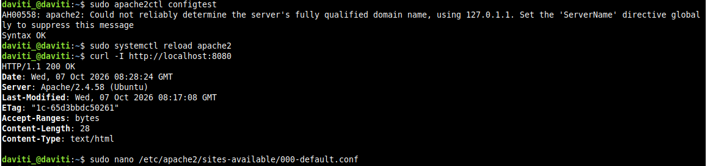

Sale Syntax OK (con el aviso de antes, que todavía no lo había quitado) y el curl al puerto 8080 da 200 OK, así que funciona. Al final de la captura se ve que vuelvo a abrir el archivo para dejar el puerto 80 otra vez, como dice la práctica.

### 6.3. Poner el nombre del servidor

Para que deje de salir el aviso AH00558:

```bash
echo "ServerName localhost" | sudo tee /etc/apache2/conf-available/servername.conf
sudo a2enconf servername
sudo systemctl reload apache2
```

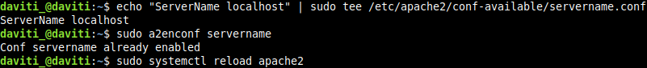

Creo un archivo con `ServerName localhost` y lo activo con `a2enconf`. Me salió "already enabled" porque ya lo había activado antes en otro intento.

Lo compruebo:

```bash
sudo apache2ctl configtest
```

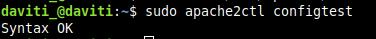

Ahora ya solo sale Syntax OK, el aviso ha desaparecido.

```bash
sudo systemctl reload apache2
sudo systemctl status apache2
```

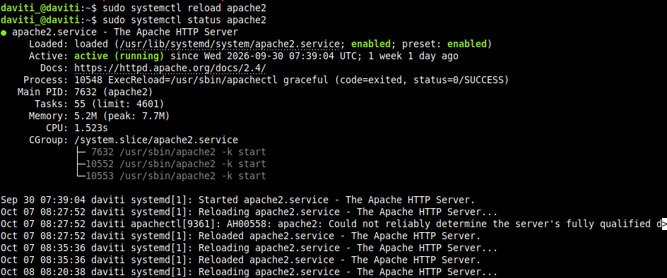

En el estado se ve que el reload ha ido bien (pone SUCCESS). También se ve que el PID principal sigue siendo el 7632, el mismo del principio, o sea que con reload Apache no se ha parado en ningún momento.

### 6.4. Cambiar el correo del administrador

```bash
sudo nano /etc/apache2/sites-available/000-default.conf
```

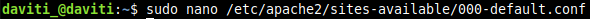

Cambio la línea de `ServerAdmin` y pongo `ServerAdmin daviti@apache2.com`:

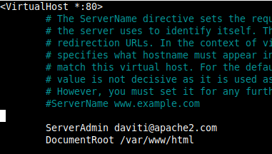

ServerAdmin es el correo del que se encarga del servidor. Sale en algunas páginas de error para que la gente sepa a quién avisar. Venía `webmaster@localhost` y lo he cambiado por el mío.

### 6.5. Página de error 404 personalizada

En el mismo archivo añado la línea `ErrorDocument 404 /404.html` antes de `</VirtualHost>`:

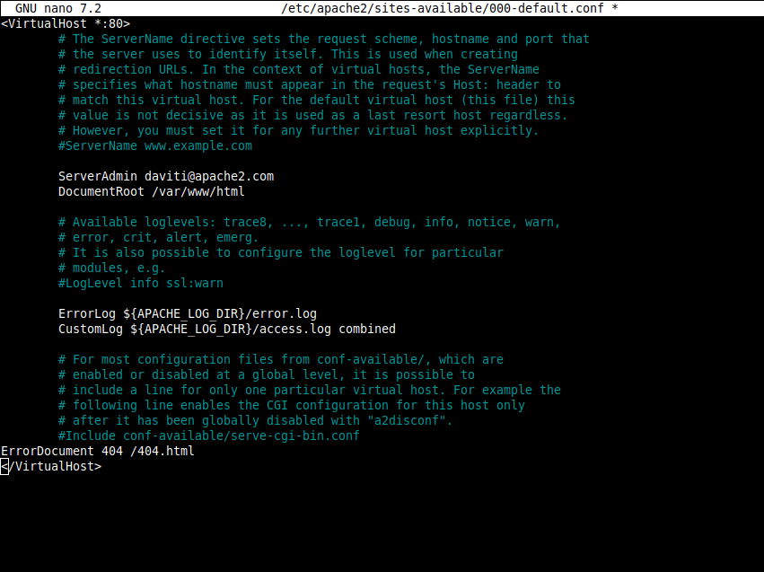

Esto hace que cuando alguien entre en una página que no existe, en vez del error normal de Apache le salga mi página 404.html. En la captura se ven los tres cambios: el puerto 80 otra vez, el ServerAdmin y el ErrorDocument.

Creo la página de error:

```bash
sudo apache2ctl configtest
echo "<h1>Error 404: Página no encontrada - Servidor de Daviti</h1>" | sudo tee /var/www/html/404.html
```

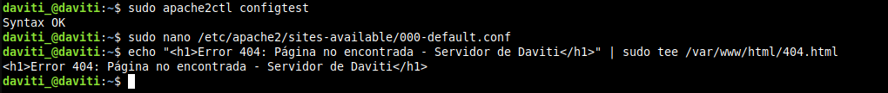

Y lo pruebo entrando en una ruta que no existe:

```bash
sudo ss -tulpn | grep apache2
curl -I http://localhost/ruta-inexistente
```

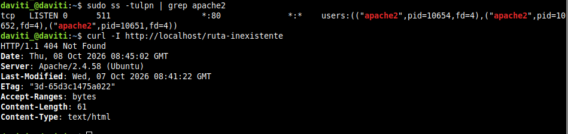

Aquí se ven dos cosas:

1. Apache vuelve a estar en el puerto 80, así que deshice bien el cambio del 8080.
2. Da 404 Not Found, pero la página que devuelve es pequeña (61 bytes) y tiene fecha de modificación (Last-Modified), o sea que es un archivo que he creado yo y no el error que genera Apache. Funciona.

---

## Apartado 7. Módulos de Apache

Apache funciona por módulos. Tiene una parte básica y luego cada cosa extra (HTTPS, redirecciones, contraseñas...) es un módulo que se activa si lo necesitas. Así no gasta memoria con cosas que no usas.

### 7.1. Ver los módulos

```bash
apache2ctl -M
ls /etc/apache2/mods-available/
```

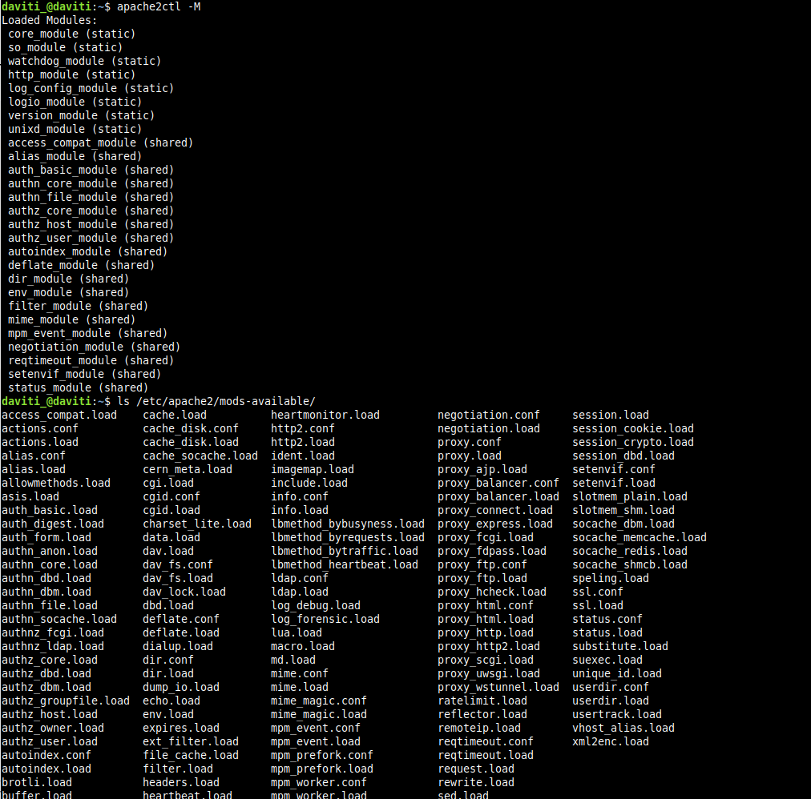

`apache2ctl -M` enseña los módulos que están cargados ahora. Hay de dos tipos:

- **static**: vienen dentro de Apache y no se pueden quitar.
- **shared**: se cargan aparte y se pueden activar o desactivar.

Y en `mods-available` salen todos los módulos que tengo instalados, que son muchísimos más.

### 7.2. Activar y desactivar módulos

```bash
sudo a2enmod rewrite
sudo a2enmod headers
sudo a2enmod ssl
sudo systemctl restart apache2
apache2ctl -M | grep -E "rewrite|headers|ssl"
```

```bash
sudo a2dismod status
sudo systemctl restart apache2
apache2ctl -M | grep status
```

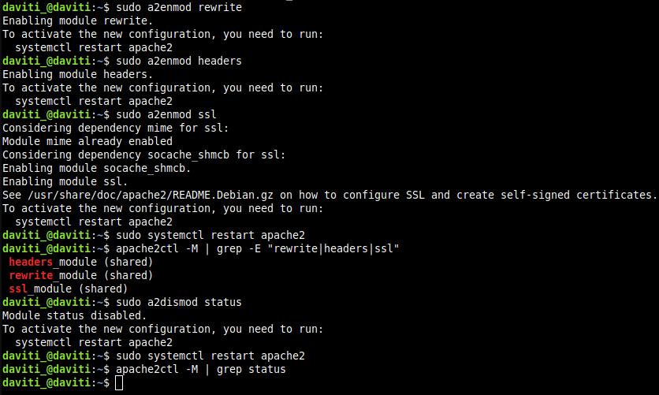

Lo que se ve en la captura:

- Cada vez que activo un módulo me dice que haga restart.
- Al activar ssl, Apache mira solo qué otros módulos necesita. mime ya estaba, pero socache_shmcb no, así que lo activa también.
- Con el grep compruebo que rewrite, headers y ssl ya están cargados.
- Después desactivo status, y al buscarlo con grep ya no sale nada, o sea que se ha quitado.

### 7.3. Tabla de módulos

| Módulo | Para qué sirve |
|---|---|
| mod_rewrite | Cambia las URL. Sirve por ejemplo para que se vean más bonitas o para mandar de HTTP a HTTPS |
| mod_headers | Para añadir o quitar cabeceras HTTP. Se usa mucho para seguridad |
| mod_ssl | Para tener HTTPS, que la conexión vaya cifrada |
| mod_dir | Hace que al entrar en una carpeta se abra solo el index.html |
| mod_alias | Para hacer redirecciones o que una URL apunte a otra carpeta |
| mod_auth_basic | Pide usuario y contraseña para entrar en una parte de la web |
| mod_status | Una página que enseña cómo está el servidor (conexiones, carga...). La he desactivado |
| mod_mime | Le dice al navegador qué tipo de archivo es cada cosa (html, png...) |
| mod_php | Para poder usar páginas en PHP. No viene instalado por defecto |

### Pregunta: ¿Qué ocurre si desactivas un módulo del que depende otro?

Pues que el otro módulo dejaría de funcionar y Apache podría no arrancar.

Pero en Ubuntu los comandos lo controlan:

- Cuando activas un módulo, también activa los que necesita. Me pasó con ssl, que activó solo socache_shmcb.
- Cuando quieres desactivar un módulo que otro necesita, `a2dismod` da un error y no te deja. Primero tienes que quitar el que depende de él.

Y si algún sitio usa algo de un módulo que has quitado, el `configtest` da error. Por eso hay que hacerlo siempre antes de reiniciar.

---

## Apartado 8. Virtual Hosts

Los virtual hosts sirven para tener varias webs en el mismo servidor. Apache sabe cuál enseñar según el nombre que pongas en el navegador. Voy a crear dos: sitio1.local y sitio2.local.

### 8.1. Crear las carpetas y las páginas

```bash
sudo mkdir -p /var/www/sitio1 /var/www/sitio2
echo "<h1>Bienvenido a SITIO 1</h1>" | sudo tee /var/www/sitio1/index.html
echo "<h1>Bienvenido a SITIO 2</h1>" | sudo tee /var/www/sitio2/index.html
```

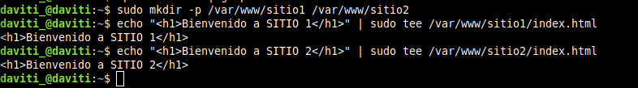

Cada web necesita su carpeta. Creo las dos y en cada una pongo un index.html con un texto distinto para saber cuál es cuál.

### 8.2. Crear la configuración de cada sitio

```bash
sudo nano /etc/apache2/sites-available/sitio1.conf
```

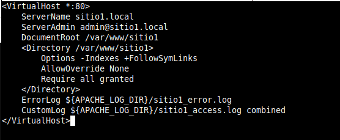

Lo que significa cada cosa:

- **ServerName**: el nombre de la web. Es lo más importante, porque es lo que usa Apache para saber qué sitio enseñar.
- **ServerAdmin**: el correo del administrador.
- **DocumentRoot**: la carpeta donde están los archivos de la web.
- **Options -Indexes**: si no hay index.html, no enseña la lista de archivos de la carpeta. Es por seguridad.
- **AllowOverride None**: no hace caso a los archivos .htaccess.
- **Require all granted**: deja entrar a todo el mundo.
- **ErrorLog y CustomLog**: cada web tiene sus propios logs, así es más fácil encontrar los errores.

```bash
sudo nano /etc/apache2/sites-available/sitio2.conf
```

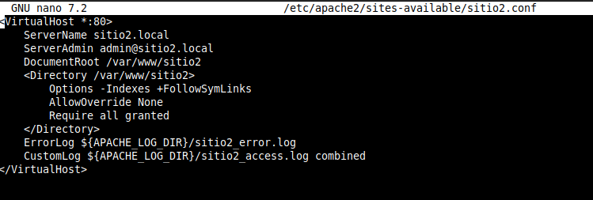

El de sitio2 es igual, solo cambiando sitio1 por sitio2.

### 8.3. Activar los sitios

```bash
sudo a2ensite sitio1.conf sitio2.conf
sudo a2dissite 000-default.conf
sudo apache2ctl configtest
sudo systemctl reload apache2
apache2ctl -S
```

Activo los dos sitios, desactivo el que venía por defecto, compruebo que no hay errores y recargo.

En la salida de `apache2ctl -S` (está en la captura del apartado 8.5) se ve que:

- Están los dos sitios, sitio1.local y sitio2.local, en el puerto 80.
- El 000-default ya no sale, así que se ha desactivado bien.
- sitio1 sale como "default server". Eso quiere decir que si alguien entra con la IP o con un nombre que no existe, le sale sitio1 (porque es el primero por orden alfabético).
- Apache funciona con el usuario www-data.

### 8.4. Archivo hosts

Como los dominios .local no existen de verdad, hay que decirle al ordenador a qué IP van. Lo pongo en `/etc/hosts`:

```bash
sudo nano /etc/hosts
```

```text
127.0.0.1     sitio1.local sitio2.local
```

El ordenador mira este archivo antes que el DNS, así que cuando escribo sitio1.local va a 127.0.0.1, que es el propio servidor. Si quisiera entrar desde otro ordenador tendría que poner la IP del servidor en el hosts de ese ordenador.

### 8.5. Pruebas

```bash
curl http://sitio1.local
curl http://sitio2.local
```

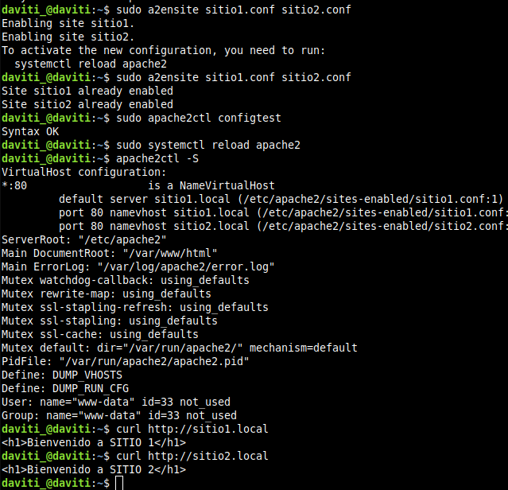

Cada nombre enseña su página, aunque los dos están en el mismo servidor y en el mismo puerto. Funciona.

### Pregunta: ¿Qué diferencia hay entre virtual hosts basados en nombre y basados en IP? ¿Cuál has usado?

- **Basados en nombre**: todas las webs usan la misma IP y Apache las distingue por el nombre que escribes en el navegador. Es lo que se usa normalmente.
- **Basados en IP**: cada web tiene una IP diferente. Necesitas varias IPs, por eso casi no se usa.

Yo he usado los **basados en nombre**, porque los dos sitios tienen `<VirtualHost *:80>` y solo cambia el ServerName. Además en `apache2ctl -S` pone "NameVirtualHost".

---

## Apartado 9. Permisos y propietarios

### 9.1. Con qué usuario funciona Apache

```bash
ps aux | grep apache2
grep -E "APACHE_RUN_(USER|GROUP)" /etc/apache2/envvars
ls -ld /var/www/sitio1 /var/www/sitio1/index.html
```

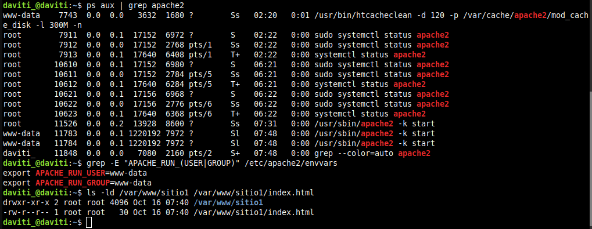

Lo que se ve:

- Hay un proceso de Apache que es de root. Es el principal, y necesita ser root para poder usar el puerto 80.
- Los demás procesos son de **www-data**. Estos son los que atienden a la gente, y así si alguien hackea la web no tiene permisos de root.
- En envvars se ve que el usuario y el grupo están puestos como www-data.
- La carpeta de sitio1 y su index.html son de root, porque los creé con sudo.

En el ps también salen unos cuantos `systemctl status apache2` que no son de Apache. Eso es porque al salir del status pulsaba Ctrl+Z en vez de q y se quedaban parados (lo explico en los problemas del final).

### 9.2. Poner bien los permisos

```bash
sudo chown -R www-data:www-data /var/www/sitio1
sudo find /var/www/sitio1 -type d -exec chmod 755 {} \;
sudo find /var/www/sitio1 -type f -exec chmod 644 {} \;
```

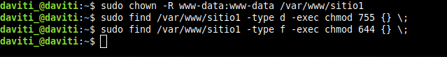

- El `chown` cambia el dueño de la carpeta y de todo lo que tiene dentro a www-data.
- El primer `find` busca solo las carpetas y les pone 755.
- El segundo `find` busca solo los archivos y les pone 644.

Uso find y no `chmod -R` porque las carpetas y los archivos necesitan permisos diferentes. Si hiciera `chmod -R 755` los archivos tendrían permiso de ejecución y no hace falta.

### 9.3. Prueba del error 403

```bash
sudo chmod 000 /var/www/sitio1/index.html
curl -I http://sitio1.local
sudo tail /var/log/apache2/sitio1_error.log
```

Si al index.html le quito todos los permisos, Apache no lo puede leer y da **403 Forbidden** (prohibido). En el log de errores sale el error AH00132, que dice que no tiene permiso para leer ese archivo. Por eso es importante mirar los logs cuando algo no va.

Luego lo dejo como estaba:

```bash
sudo chmod 644 /var/www/sitio1/index.html
```

### Qué significan 755 y 644

Cada número es para un tipo de usuario: el primero para el dueño, el segundo para el grupo y el tercero para los demás. Y cada número es una suma: leer = 4, escribir = 2 y ejecutar = 1.

- **755**: el dueño puede todo (4+2+1 = 7) y el resto solo leer y entrar (4+1 = 5). Se usa en carpetas, porque en una carpeta la x es lo que te deja entrar.
- **644**: el dueño puede leer y escribir (4+2 = 6) y el resto solo leer (4). Se usa en archivos.

Así Apache puede leer la web, pero solo el dueño la puede cambiar.

### Por qué nunca se deben usar permisos 777

Porque 777 significa que **cualquiera** puede leer, escribir y ejecutar el archivo. En un servidor web eso es muy peligroso: si alguien encuentra un fallo en la web, podría cambiar las páginas o subir un virus y ejecutarlo. Mucha gente lo pone para arreglar rápido un problema de permisos, pero es abrir un agujero de seguridad.

### Por qué el contenido web no debe ser de root ni escribible por todos

- **No debe ser de root** porque cada usuario solo debe tener los permisos que necesita. Para la web no hace falta root, y si todo es de root cualquier error es más peligroso.
- **No debe poder escribirlo cualquiera** porque si alguien entra por un fallo podría cambiar la web y usarla para engañar a la gente o meter virus.

Lo mejor es que Apache solo pueda leer, y que solo el que administra la web pueda escribir.

---

## Conclusiones y problemas

### Conclusiones

Con esta práctica he aprendido a montar un servidor web con Apache desde cero, hasta tener dos webs diferentes en el mismo servidor. Lo que más me ha servido:

- Comprobar las cosas con `systemctl status`, `ss` y `curl` para saber si funciona sin tener que abrir el navegador.
- Lo de available y enabled con enlaces, que hace muy fácil activar y desactivar sitios y módulos.
- Hacer siempre `configtest` antes de recargar, para no dejar Apache roto.
- Usar reload en vez de restart cuando se puede, para no cortar a nadie.
- Los permisos también son seguridad: 755 para carpetas, 644 para archivos y nunca 777.
- Hacer copia de seguridad antes de tocar un archivo.

### Problemas que he tenido

**El aviso AH00558.** Me salía cada vez que hacía `configtest` o arrancaba Apache. Era porque no tenía puesto el ServerName. Lo arreglé creando el archivo servername.conf con `ServerName localhost` y activándolo con `a2enconf` (apartado 6.3).

**La terminal se quedaba parada con "[1]+ Stopped".** Cuando hacía `systemctl status` no sabía cómo salir y pulsaba Ctrl+Z, pero eso no cierra el comando, lo deja parado en segundo plano. Por eso luego en el `ps aux` me salían varios. Para salir bien hay que pulsar **q**.

**Me salía "already enabled".** Al hacer `a2enconf` o `a2ensite` me decía eso porque ya lo había activado antes. No es un error, simplemente ya estaba hecho.

**Volver a poner el puerto 80.** Después de cambiar al 8080 tuve que acordarme de cambiar los dos archivos otra vez (ports.conf y 000-default.conf). Lo comprobé con `ss` y volvía a salir el 80.

**Permiso denegado con echo.** Si haces `sudo echo "..." > archivo` da error de permisos, porque el `>` lo hace tu usuario normal. Por eso he usado `echo "..." | sudo tee archivo`.

---

[Volver al README](README.md)
